<div align="center">


# EasySell

**An AI finance copilot for the world's neighbourhood shops.**<br/>
Sell by voice or camera. EasySell records every sale, warns about money problems early,<br/>
and shows which loans the shop is ready for.

[](https://flutter.dev)
[](https://supabase.com)
[](https://ai.google.dev)
[](docs/hackathon/evidence/results/flutter_test.txt)
[](#-try-it)
[](#-features)

[**Try it**](#-try-it) · [**Features**](#-features) · [**How it works**](#-how-it-works) · [**Proof**](#-proof-it-works) · [**Run it yourself**](#-run-it-yourself) · [**Roadmap**](#-roadmap)

<br/>

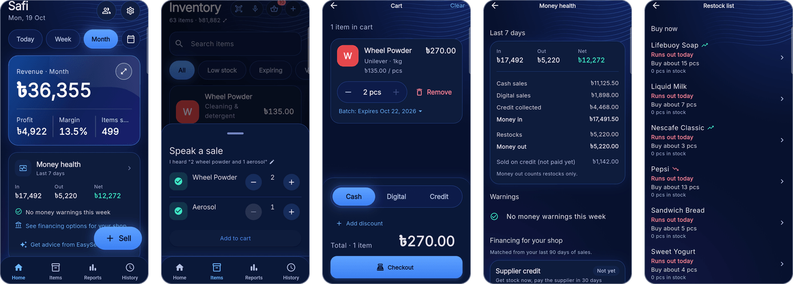

</div>

---

## 🧭 The problem

Small shops in emerging markets run on memory and a paper notebook.

| Pain | What it costs the owner |
|---|---|
| **No real numbers** | They rarely know their true profit, the cash stuck in stock, or how much customers owe them. |
| **Warnings come late** | Unpaid credit piles up and restocking drains the cash drawer. They notice only when there is no cash for the next delivery. |
| **Locked out of finance** | No records means no proof they can repay. Small businesses in emerging economies face a **US$5.7 trillion financing gap** ([SME Finance Forum](https://www.smefinanceforum.org/news/11541348)). |
| **Typing apps don't stick** | Bookkeeping apps need typing at a busy counter, and many owners are not comfortable typing. |

**EasySell's answer:** make record-keeping effortless with voice and camera, then turn those records into money advice and a path to a loan.

---

## 📲 Try it

> [!TIP]
> **Download the Android app:** [EasySell on Google Drive](https://drive.google.com/drive/folders/1h3die1T97oPDPKwlZ-UREM6sAegyUAjn?usp=sharing).
> The folder holds the APK and a short read-me with a **demo login** for a shop that is already full of data (US dollars, English).

<details>
<summary><b>How to install the APK (3 steps)</b></summary>

<br/>

1. Open the link **on an Android phone** (Android 7.0 or newer) and download `EasySell-1.1.0-hackathon.apk`. If Chrome warns about the file, tap **Download anyway**.
2. Open the file. If asked, allow your browser or Files app to **install unknown apps**.
3. If Google Play Protect says the app is unknown, tap **More details**, then **Install anyway**. This appears only because the app is not on the Play Store yet.

To check the file was not changed, its SHA-256 is:

```
0fb6daae97e97781c78dec55efb981586b2f39137c1f4fab103c65a2a64bc6bd
```

</details>

<details>
<summary><b>What to try first</b></summary>

<br/>

- [ ] **Home:** switch between Today, Week and Month, and tap a day on the sales chart.
- [ ] **Sell by voice:** tap the mic and say *"two Pepsi and one Lux soap"*.
- [ ] **Sell by camera:** tap the camera and point it at a product.
- [ ] **Money health:** open the card and tap **Get advice from EasySell AI**.
- [ ] **Financing:** see which loan types the shop is ready for, and what is missing.
- [ ] **Restock list:** what to buy, and how much.
- [ ] **Settings → Language → বাংলা:** the whole app switches to Bangla.

</details>

---

## ✨ Features

Click a feature to open it.

<details>
<summary><b>🎙️ Sell by voice</b>: say the sale, check it, add it to the cart</summary>

<br/>

Tap the mic and say the sale, for example *"two Pepsi and one kilo of onion"*, in English or Bangla. Gemini writes down what it heard and matches each item to the shop's own products. The owner checks the list, can edit the heard sentence and resend it, then adds the items to the cart.

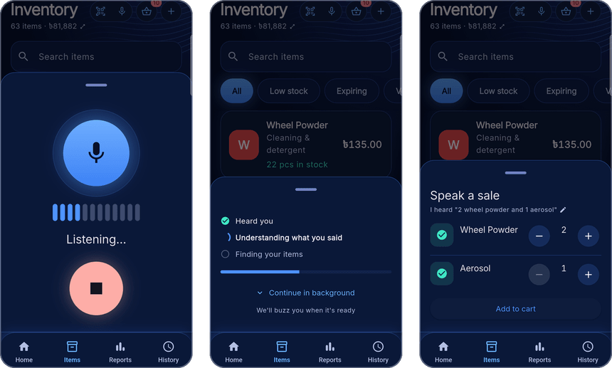

Bangla number words such as আড়াই (2.5) and দেড় (1.5) are corrected by fixed code after Gemini replies.

</details>

<details>
<summary><b>📷 Sell by camera</b>: tap once per item, then review in one tray</summary>

<br/>

Point the camera at products and tap once for each item. Each photo is matched to the shop's product list, and the results collect in one review tray. If two products look alike (Pepsi 500 ml and 1 L), both are shown and the owner picks.

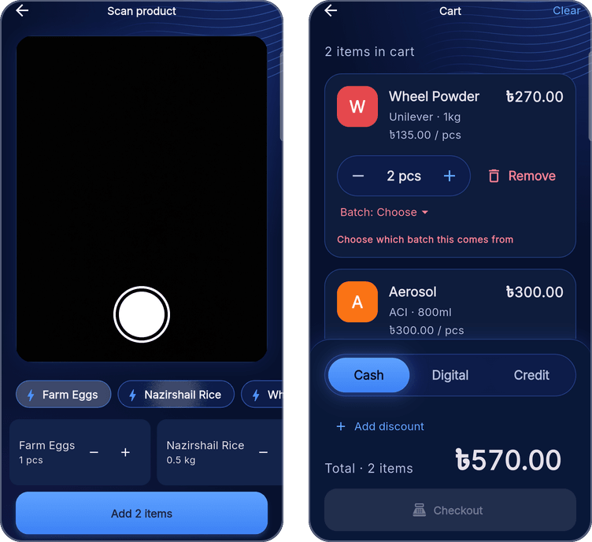

</details>

<details>
<summary><b>🛒 One-tap checkout</b>: cash, digital or credit, with a discount</summary>

<br/>

A multi-item cart with undo, a flat discount (split exactly across the items), and a payment method: **Cash**, **Digital** or **Credit** (credit goes to a named customer). One tap saves the whole sale.

> [!IMPORTANT]
> **Nothing from the AI is saved until the owner checks it and taps Checkout.** A wrong AI guess costs one tap, never a wrong record.

</details>

<details>
<summary><b>📊 Business analysis</b>: dashboard, reports and sales history</summary>

<br/>

Revenue, profit, margin and items sold for today, this week, this month or any picked day. A 7-day sales chart, best sellers, sales by category, and every receipt in Sales history. All totals are summed inside the database, so the phone only displays them.

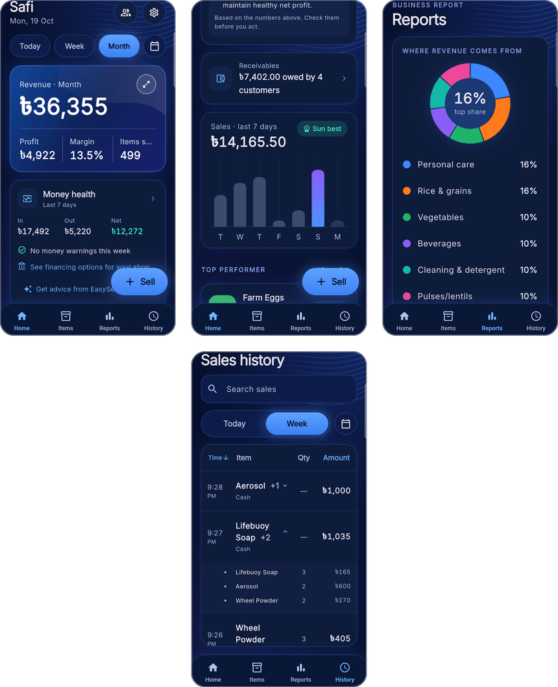

</details>

<details>
<summary><b>💓 Money health</b>: money in, money out, and four early warnings</summary>

<br/>

The last 7 days of **money in** (cash and digital sales, plus credit customers paying back), **money out** (restocking) and **net**. Four fixed rules warn early:

| Warning | When it fires |
|---|---|
| ⏰ Late credit | A customer is **30+ days** late paying (names the biggest debtor) |
| 📦 Restock squeeze | Restocking cost **more than the money that came in** this week |
| 📈 Credit growing | Money owed by customers grew **20%+** in a week |
| 📉 Sales falling | Sales fell **25%+** from the week before |

**AI money advice:** one tap sends the card's already-calculated numbers to Gemini, which writes 1–3 short tips in the owner's language. Every amount in a tip is copied from the card. The AI never calculates money.

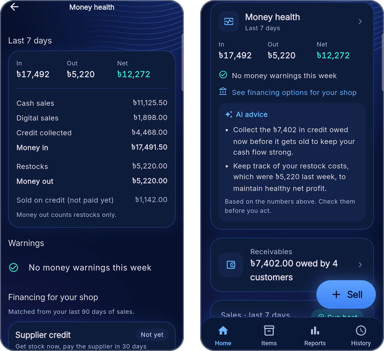

</details>

<details>
<summary><b>🏦 Financing matching</b>: which loans the shop is ready for</summary>

<br/>

Four **example** loan types, small to large: supplier credit, a mobile-wallet small loan, a microfinance shop loan and a bank SME loan. Each is checked against the shop's **own last 90 days**: months trading, weeks with sales, profit margin, share of digital sales and credit owed. The result is **"Fits you"** with a rough amount, or **"Not yet"** with the next step.

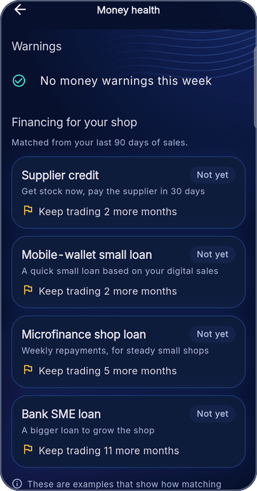

> [!NOTE]
> The loan types are illustrative examples, not real offers. No lender is connected yet.

</details>

<details>
<summary><b>🔁 Restock planner</b>: what to buy, and exactly how much</summary>

<br/>

Pure arithmetic on the shop's own records, no AI. For each product, the database looks at the last 28 full days as 4 weeks, and counts only the days the item was actually in stock (so a sold-out item doesn't look slow). Recent weeks count more:

$$\text{speed per day} = \frac{0.4\,r_1 + 0.3\,r_2 + 0.2\,r_3 + 0.1\,r_4}{\text{sum of the weights of weeks that had stock}}$$

where $r_k$ is units sold in week $k$ divided by the days it was in stock that week. Then:

$$\text{buy} = \left\lceil \text{speed} \times (\text{restock days} + 2) - \text{good stock} \right\rceil$$

**Example:** 5 a day × (7 + 2) − 10 left = **buy 35**.

- Good stock = stock on the shelf minus expired units.
- An item at or below its reorder level is always **Buy now**.
- Red if fewer than 3 days of stock are left; arrows show sales rising or falling (±20%).

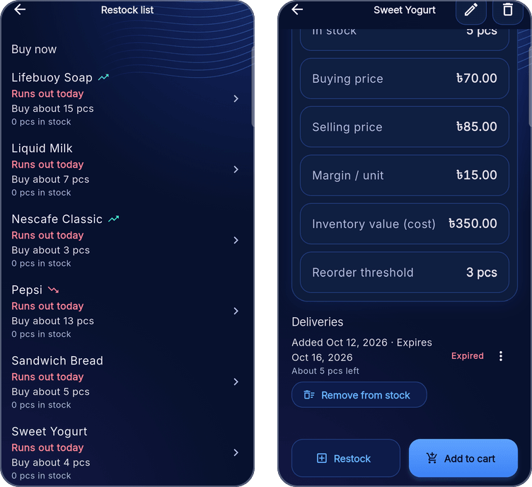

</details>

<details>
<summary><b>🗓️ Expiry tracking and batch choice</b>: sell the oldest first, never sell expired stock</summary>

<br/>

Each delivery (batch) can have its own expiry date. The app estimates what is left of each one (oldest sells first) and shows **Good**, **Expiring soon** or **Expired**. Expired units are locked: they can't be sold and don't count as stock.

If an item in the cart can come from two or more batches, the cart shows **Batch: Choose** and **Checkout stays off** until the owner picks. The server checks the chosen batch in the same transaction as the sale.

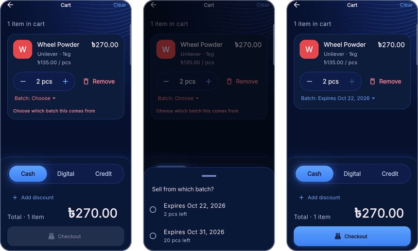

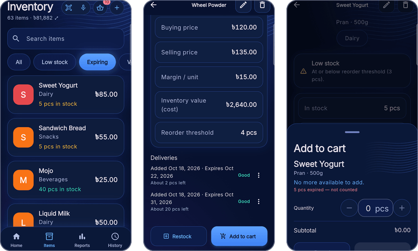

</details>

<details>
<summary><b>🌐 English and Bangla</b>: the whole app, including numbers</summary>

<br/>

Every screen is translated, with Bengali digits. Each shop keeps its own currency (US dollar or Bangladeshi taka).

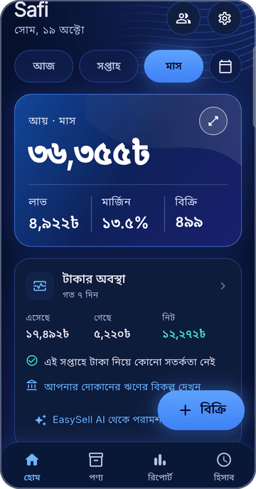

</details>

<details>
<summary><b>📒 Everyday tools</b>: customer credit book and inventory</summary>

<br/>

- **Customer credit book:** a running balance per customer, a ledger of credit sales and payments, and recording a payment.
- **Inventory:** products sold by piece, weight or volume; prices; stock; reorder levels; categories; archive.

</details>

---

## ⚙️ How it works

The app talks only to Supabase. Supabase holds the data, checks who is signed in, and calls Gemini. **The Gemini key never reaches the phone.**

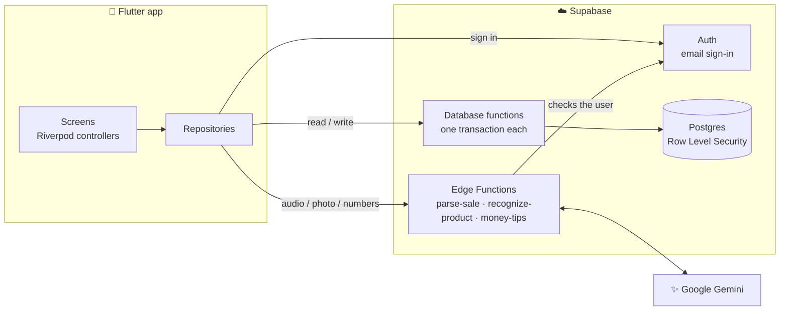

<details>
<summary><b>Walk through one voice sale</b></summary>

<br/>

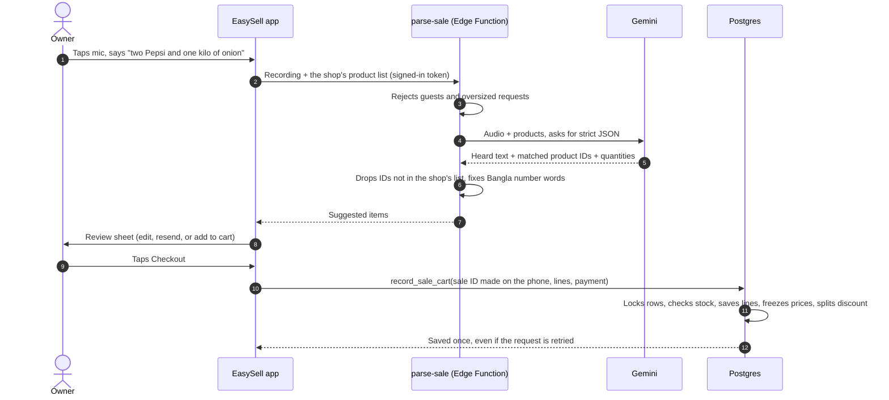

</details>

<details>
<summary><b>Data model</b></summary>

<br/>

10 tables, built by 20 migration files. Every business row belongs to one shop, and Row Level Security lets a signed-in user see only their own shop's rows. One receipt is several `transactions` rows sharing a `sale_group_id`.

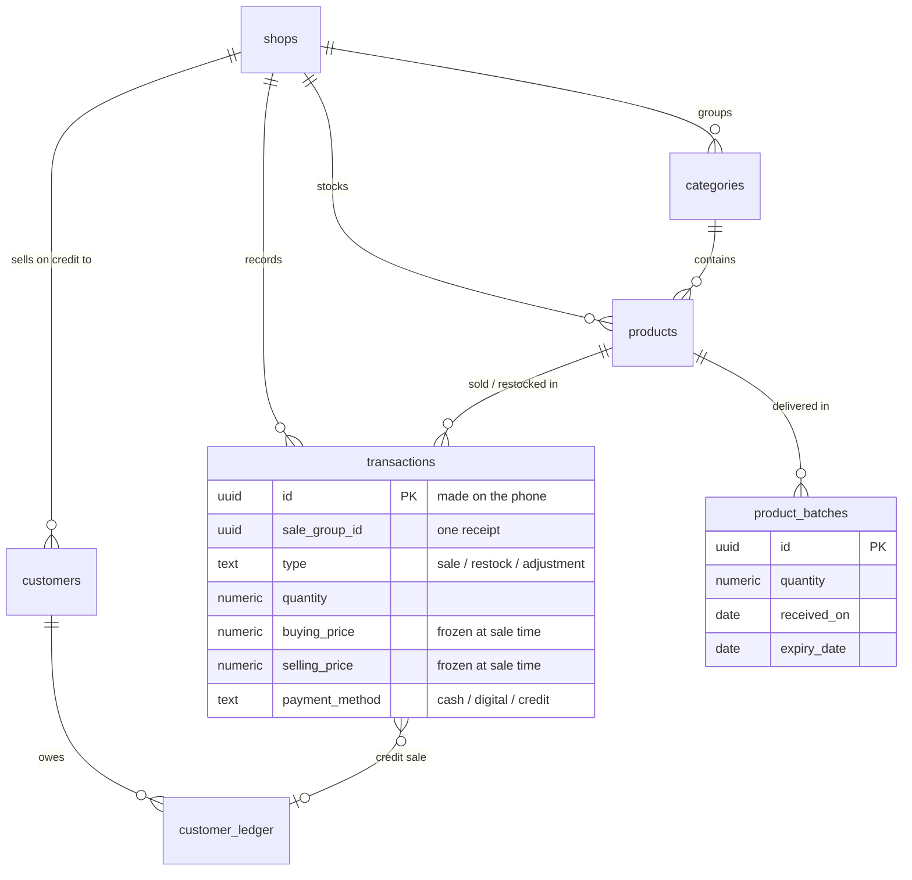

</details>

<details>
<summary><b>Money safety rules</b></summary>

<br/>

- **Atomic checkout:** one database function locks each product row, checks stock, lowers it, saves the sale lines, splits the discount and records credit. If one line fails, nothing is saved.
- **Stock never goes below zero:** a database rule plus row locks.
- **Frozen prices:** each sale line stores that moment's buying and selling price, so past profit never changes.
- **Safe retries:** the phone creates an ID for every sale, restock, stock removal and credit payment, and the server records each ID once.
- **Local days:** "today" follows the shop's own midnight, not UTC.
- **Credit balances are always summed** from the ledger, never stored.

</details>

<details>
<summary><b>AI safeguards</b></summary>

<br/>

**The rules decide; the AI only puts things into words.**

- Every call asks Gemini for strict JSON, and the server checks the reply (unknown product IDs dropped, confidence limited to 0–1, at most 3 tips).
- The owner confirms every voice and camera result.
- Money advice gets every amount pre-formatted, and the prompt forbids changing or adding numbers.
- Output token caps and 15–20 second time limits. Advice runs only on tap and is saved for the day.

| Job | Model |
|---|---|
| Voice sale | Gemini 3.5 Flash-Lite |
| Camera scan | Gemini 3.6 Flash |
| Money advice | Gemini 3.6 Flash |

</details>

### Tech stack

| Layer | Technology |
|---|---|
| App | Flutter 3.44 (Dart), Material 3, Riverpod 3, go_router 17, fl_chart |
| Backend | Supabase: PostgreSQL, Auth, Edge Functions (Deno, TypeScript) |
| Server logic | PL/pgSQL database functions; every money change is one transaction |
| AI | Google Gemini, called only from the server |
| Device | camera, audio recording, local notifications |

---

## ✅ Proof it works

On 19–20 October 2026 we tested the **live** system: the real AI functions, the real database and the real security rules. Every number below comes from a script in [`docs/hackathon/evidence/`](docs/hackathon/evidence/), with the raw results saved next to it.

| What we tested | Result |
|---|---|
| 🎙️ AI voice selling, 20 spoken sales | **19 / 20** fully right; **10 / 10 in Bangla**; 2.0 s median |
| 📷 AI camera selling, 13 photos | **12 / 13** right, including 2 / 2 things the shop doesn't sell |
| 💵 AI cost (estimated) | about **US$0.0013** a voice sale, **US$0.0023** a photo |
| 🔒 Money safety on the live database | **7 / 7** checks; **10 / 10** races for the last item |
| 🛡️ Security, tested from outside | **13 / 13** checks |
| 🧪 Automated tests | **715 / 715** passed; code checker: no issues |
| 🚀 Deployment | **8 / 8** live checks; release app on a real phone |

<details>
<summary><b>What the money-safety test did</b></summary>

<br/>

| Check | What happened |
|---|---|
| Two phones sell the last item at the same moment (10 rounds) | Every round: 1 sale saved, 1 refused. Stock never below 0 |
| A sale is sent twice (lost reply, then retry) | Only 1 sale saved |
| A cart with one bad line | The whole cart refused, including the good line |
| Setting stock to −1 directly | Refused by a database rule |
| The price changes after a sale | The saved sale keeps the old price |
| A credit payment is sent twice | Only 1 payment saved |
| A payment larger than the debt | Refused |

</details>

<details>
<summary><b>What the security test did</b></summary>

<br/>

**With only the public key** (which ships inside every copy of the app): every table returned 0 rows, the AI functions answered "401", guest sign-in was refused, and there is no public file storage.

**As a signed-in owner of shop B, going after shop A:** 0 rows from every table, a dashboard of zeros, and every attempt to sell, edit or add in shop A refused.

</details>

<details>
<summary><b>Run the tests yourself</b></summary>

<br/>

```bash
flutter test      # 715 tests: money rules, restock, expiry, warnings, financing, screens
flutter analyze   # no issues
```

The live checks (`ai_benchmark.mjs`, `money_safety.mjs`, `security_probe.mjs`, `deployment_check.mjs`) need your own Supabase project. See [`docs/hackathon/evidence/README.md`](docs/hackathon/evidence/README.md).

</details>

---

## 🛠️ Run it yourself

<details>
<summary><b>1. Set up Supabase</b></summary>

<br/>

1. Create a project at [supabase.com](https://supabase.com/dashboard).
2. In the **SQL Editor**, run every file in [`supabase/migrations/`](supabase/migrations/) **in filename order** (`0001` to `0020`).
3. Add your Gemini key as an Edge Function secret, then deploy the three functions:

```bash
supabase secrets set GEMINI_API_KEY=your-gemini-key
supabase functions deploy parse-sale
supabase functions deploy recognize-product
supabase functions deploy money-tips
```

More detail: [`supabase/README.md`](supabase/README.md).

</details>

<details>
<summary><b>2. Run the app</b></summary>

<br/>

```bash
flutter pub get
cp dart_defines.example.json dart_defines.json   # then paste your Project URL and anon key
flutter run --dart-define-from-file=dart_defines.json
```

`dart_defines.json` is git-ignored. Only the public anon key goes in the app; the Gemini key stays on the server.

</details>

<details>
<summary><b>3. (Optional) Load demo data</b></summary>

<br/>

Sign up in the app first, then run [`supabase/seed/demo_data.sql`](supabase/seed/demo_data.sql) in the SQL Editor. It fills your newest shop with 55 products, 5 weeks of sales, 4 credit customers, a restock and expiry dates. [`remove_demo_data.sql`](supabase/seed/remove_demo_data.sql) takes it out again.

</details>

<details>
<summary><b>4. Build a release APK</b></summary>

<br/>

```bash
flutter build apk --release --dart-define-from-file=dart_defines.json
```

</details>

<details>
<summary><b>Project structure</b></summary>

<br/>

```
lib/
  core/         config, theme, router, errors, shared widgets
  features/     one folder per feature, each split into data / domain / presentation
    auth  onboarding  dashboard  analytics  transactions  cart  voice  scan
    inventory  expiry  restock  customers  finance  settings  shell
  l10n/         English and Bangla text
  shared/       providers used across features
supabase/
  migrations/   20 SQL files: tables, security rules, database functions
  functions/    parse-sale, recognize-product, money-tips (Deno)
  seed/         demo data
test/           715 tests: logic and screen tests
docs/
  00-Map.md     index of every design note
  superpowers/  dated design notes and build plans
  hackathon/    evidence scripts and results
```

</details>

---

## 🗺️ Roadmap

**Built**

- [x] Voice and camera selling with owner confirmation
- [x] Atomic, retry-safe checkout with cash, digital and credit
- [x] Dashboard, reports and sales history
- [x] Money health with four warnings, and AI money advice
- [x] Financing matching against the shop's own records
- [x] Restock planner, expiry tracking and batch choice
- [x] English and Bangla; US dollar and taka

**Next**

- [ ] **Real lender partners:** turn "Fits you" into an application, with the owner's consent
- [ ] **Export data:** sales, stock and credit as CSV (Excel), plus a monthly PDF report for lenders
- [ ] **Offline mode:** save sales on the phone first, then sync to Supabase when back online
- [ ] **More languages and currencies** for the Philippines, Kenya, Nigeria, Indonesia and Mexico
- [ ] **"Ask EasySell" chat** for money questions in the owner's language
- [ ] Record other expenses, so "money out" is complete

<details>
<summary><b>How it was built</b></summary>

<br/>

Every feature followed the same path: a dated design note explaining *why* (the decisions, and the options rejected), then a build plan, tests and a check on a real phone. All notes are indexed in [`docs/00-Map.md`](docs/00-Map.md).

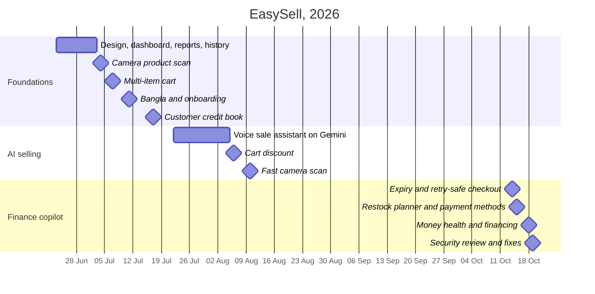

</details>

---

## ⚠️ Honest limits

- **No real shops use the app yet.** All data is test or demo data.
- The AI was tested with computer voices and web photos. A noisy shop counter may score lower.
- Every sale needs internet. Offline mode is designed but not built.
- Android only (the code is ready for iOS, but it is not built or tested there).
- Before a public launch: a private release signing key, email confirmation, and a daily AI limit per user.

<div align="center">

<br/>

Built for the **SME Finance Copilot** track (Topic E) of a fintech hackathon, 2026.

</div>
